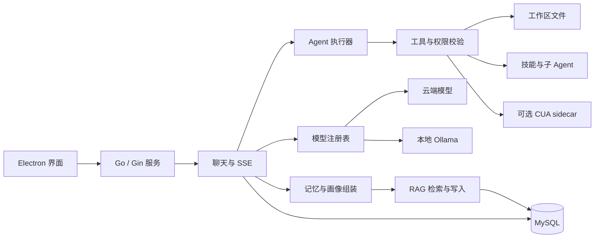

# Moon Agent（blog-my）

一个以 Windows 桌面端为主的私人 AI 助手项目。GitHub 仓库名为 **moon-agent**，桌面应用当前产品名为 **blog-my**。项目由 Electron 界面、Go 服务、模型接入、Agent 工具执行和 MySQL 记忆组成，适合本地运行和继续开发。

## 功能一览

| 能力 | 说明 |
| --- | --- |
| 多模型对话 | 内置 DeepSeek、OpenAI、Grok（xAI）、Moonshot、通义千问、智谱、Claude、Gemini、文心和 Ollama 端点。云端模型需要自己的 API Key。 |
| 流式对话 | 通过 SSE 推送文本增量、工具调用、工具结果、等待输入和完成状态；界面可展开执行详情。 |
| Agent 执行 | 默认使用 Eino ReAct，同时保留 legacy 执行器用于回退和对照。可调用工作区文件工具、技能、子 Agent 和团队能力。 |
| 执行权限 | `plan`、`confirm`、`auto` 模式控制规划、风险操作确认和自主执行；服务端和工具仍会校验权限。 |
| 记忆与知识库 | 文档切块后融合向量、关键词和实体线索；自动记忆及用户画像可按需进入后续对话上下文。 |
| 助手设定 | 用户画像与助手人格分开管理；人格配置包含性格、说话方式和做事方式等维度。 |
| 多工作区 | 一个会话可选择多个活动目录；文件工具仍按工作区和执行模式限制访问范围。 |
| 电脑操作（可选） | `cua/` 提供 Python CUA sidecar，需要单独安装依赖或构建。 |

项目不提供托管推理服务，也不包含模型凭证。Ollama 可用于本地对话或知识库嵌入；需自行安装所需模型并承担本地推理资源开销。

## 架构



Electron 在本机启动 Go 服务并加载界面。独立运行 Go 服务时，默认监听 `127.0.0.1:8080`。会话、用户设置、知识库文档、切块和向量由 MySQL 持久化；向量目前保存在 MySQL 中并由 Go 进程计算排序，不依赖独立向量数据库。

## 快速开始

### 环境要求

- Windows 10/11（当前主要开发和打包目标）
- Go `1.25.3`（以仓库 `go.mod` 为准）
- Node.js `24+` 和 npm
- 可连接的 MySQL 数据库
- 可选：Ollama（本地模型或知识库嵌入）
- 可选：Python 及 [`cua/requirements.txt`](cua/requirements.txt) 中的依赖（电脑操作）

### 安装与启动

在项目根目录打开 PowerShell：

```powershell
npm ci
Copy-Item .env.example .env
```

编辑 `.env`，填写 MySQL 连接信息，并生成固定的 `APP_SECRET`：

```powershell
node -e "console.log(require('crypto').randomBytes(32).toString('hex'))"
```

把命令输出写入 `.env` 的 `APP_SECRET`。数据库初始化会按 Go 数据模型建立或迁移表；运行账号需要相应的数据库权限。启动桌面开发版：

```powershell
npm run dev
```

`npm run dev` 会先构建 Go 后端，再启动 Electron。只运行 HTTP 服务时执行：

```powershell
go run ./cmd/blog-my
```

开发模式从仓库根目录读取 `.env`。安装版从 Electron 用户配置目录读取 `.env`，首次启动会创建配置模板。**升级时保留原来的 `APP_SECRET`**：它用于加密已保存的 API Key，更改后旧 Key 将无法解密。安装包不会包含开发机的 `.env`。

### 可选：连接 Ollama

知识库默认使用 `bge-m3:latest` 生成嵌入，图片转文字默认使用 `qwen2.5vl:7b`。按需拉取：

```powershell
ollama pull bge-m3:latest
ollama pull qwen2.5vl:7b
```

本地聊天模型、嵌入模型和视觉模型用途不同，可在配置与模型页面分别设置。使用云端模型时，在应用里填入对应 API Key 即可。

## Agent 配置

完整默认值见 [`.env.example`](.env.example)。常用变量：

| 变量 | 用途 |
| --- | --- |
| `AGENT_ENGINE` | 执行器；默认 `eino`，`legacy` 用于回退对照。 |
| `AGENT_TOOLS` | Agent 工具总开关。 |
| `AGENT_FS_ROOT` | 文件工具沙箱根目录。建议使用专用工作区，不要指向整个用户目录或仓库根目录。 |
| `AGENT_MODE` | 默认执行模式：`plan`、`confirm` 或 `auto`；界面和单次请求可以覆盖。 |
| `AGENT_MAX_ITERATIONS`、`AGENT_MAX_TOOL_CALLS` | 每个执行阶段的模型轮数和工具次数预算。 |
| `AGENT_LIMIT_RECOVERY_ROUNDS` | 自主模式触顶后的自动续行阶段数。 |
| `AGENT_AUTO_MEMORY` | 是否将对话整理为后续可检索的记忆。 |
| `AGENT_PROFILE_EVERY_TURNS` | 用户画像刷新的轮数间隔。 |
| `AGENT_MAX_DEPTH`、`AGENT_MAX_CHILDREN` | 子 Agent 最大委派深度和并发数量。 |

`confirm` 模式会在需要确认的操作前等待用户；`auto` 允许 Agent 自行处理常规决策，但缺少必要信息或遇到权限限制时仍可能暂停。预算续行不保证模型一定完成任务，请以界面中的执行记录和最终状态为准。

## 常用命令

| 命令 | 用途 |
| --- | --- |
| `npm run dev` | 构建后端并启动 Electron 开发版。 |
| `npm start` | 启动开发入口；需要已有后端构建产物。 |
| `go run ./cmd/blog-my` | 在终端启动 Go HTTP 服务。 |
| `npm run build` | 构建 Go 后端到 `bin/`。 |
| `npm test` | 工具链、Electron、Go 单元测试及离线页面回归。 |
| `npm run check` | 工具链检查和 Go vet。 |
| `npm run test:go -- -count=1 -timeout=180s` | 强制重新运行后端测试。 |
| `npm run test:ui:taskcard` | 额外运行任务卡页面回归。 |
| `npm run dist:dir` | 构建 `dist/win-unpacked/`。 |
| `npm run dist` | 构建 Windows 安装包。 |
| `npm run build:cua-sidecar` | 使用 PyInstaller 构建 CUA sidecar。 |

CUA 打包前需安装 Python 依赖和 PyInstaller。Go 构建脚本使用工作区缓存，并尊重已有的 `GOCACHE`、`GOMODCACHE`、`GOTMPDIR`、`TEMP` 和 `TMP`。安装包包含后端、页面模板和 `skills/`；`examples/`、`docs/` 和构建缓存不进入安装包。

## 测试范围

常规 `npm test` 主要运行本地、模拟模型和离线回归，不会自动连接真实模型服务。真实服务测试需要额外配置；请使用专用测试库，避免对日常数据执行迁移或写入：

```powershell
$env:DB_NAME = 'blog_my_refactor_test'
$env:AGENT_IT = '1'
node scripts/go.cjs test -run 'TestChatHTTP|TestAutonomousHTTPExecution|TestPermHTTPMatrix' -count=1 -timeout=180s
Remove-Item Env:AGENT_IT
Remove-Item Env:DB_NAME
```

- `KB_STORE_IT=1`：启用真实 MySQL 固定向量检索测试，需显式设置专用 `DB_NAME`。
- `KB_IT=1`：启用真实 MySQL 与 Ollama 记忆集成测试。
- `AGENT_LIVE_MODEL`：指定已安装的 Ollama 模型，启用真实模型文件任务测试。

离线测试通过不代表外部模型 Key、Ollama 服务或 CUA 桌面环境已完成在线验收。测试入口及覆盖边界见 [`scripts/`](scripts/) 和 [`docs/verify/`](docs/verify/) 中的记录。

## 数据与安全

- `.env`、构建输出、用户工作区和 `artifacts/` 已由 `.gitignore` 排除。不要把真实 API Key、数据库密码、数据库导出或个人文档提交到仓库。
- 用户 API Key 在数据库中以密文保存；`APP_SECRET` 必须保密并稳定保存。丢失或更换它可能导致已保存的 Key 无法解密。
- 给 `AGENT_FS_ROOT` 指定专用、可恢复的工作目录。文件工具会按工作区和执行模式校验访问范围；配置过宽仍会扩大 Agent 可操作范围。
- CUA 会在本机桌面执行动作。启用前确认模型、屏幕和当前工作环境适合自动化操作。
- MySQL 是应用的持久化边界；更换目录或重装程序不会自动搬运、备份或清理数据库数据。

## 项目结构

- `cmd/`：Go 可执行入口。
- `internal/app/`：应用启动、依赖组装与关闭。
- `internal/web/`：HTTP、SSE、页面接口和业务接线。
- `internal/agent/`：Eino/legacy 执行器、工具安全和子 Agent。
- `internal/llm/`：模型端点、供应商适配和注册表。
- `internal/model/`：GORM 数据模型、数据库初始化与迁移。
- `internal/rag/`：文档入库、切块、召回和自动记忆。
- `electron/`、`templates/`：桌面窗口、后端进程、HTML 页面与静态资源。
- `cua/`、`packaging/`：Python 电脑操作框架和 sidecar 打包定义。
- `skills/`：随桌面应用打包的技能。
- `scripts/`：构建、测试、验收和开发辅助脚本。
- `db/`、`docs/`：数据库参考、架构说明、使用文档和验证记录。
- `examples/`：独立示例，不参与桌面应用打包。

## 文档导航

- [项目架构与数据流](docs/architecture.md)
- [Agent 使用、执行模式和工作区权限](docs/agent/03-usage.md)
- [工具清单与行为约束](docs/agent/02-tools.md)
- [Eino 执行器、预算和续行](docs/agent/08-eino-runtime.md)
- [技能系统](docs/agent/04-skills.md)
- [子 Agent 与团队](docs/agent/05-subagent-and-team.md)
- [HTTP / SSE API 契约](docs/api-contract.md)
- [数据库结构说明](db/schema.md)
- [本轮目录整理与验证记录](docs/verify/refactoring-2026-10-19.md)
- [应用布局 ADR](docs/adr/0001-application-layout.md)

## 贡献与问题反馈

提交改动前建议运行：

```powershell
npm run check
npm test
```

涉及真实 MySQL、Ollama、外部模型或 CUA 的验证，请在说明中标明环境变量和实际运行环境。报告问题时提供复现步骤、预期行为、实际结果和相关日志；先删除个人数据与凭证，不要把 API Key 或数据库密码贴入 Issue。
