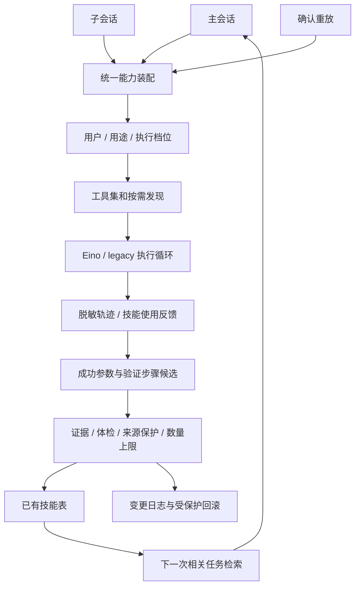

# ADR-0002：统一工具装配与受约束的经验学习

状态：已实现。日期：2026-10-21。

## 问题

工具在原工具表之后直接追加，会绕过会话用途、确认和子级权限。静态绑定的模型工具表也无法表达运行中发现的新工具。学习代码只有生成候选而缺少真实参数、后续检索和反馈时，不能形成有据可查的复用流程。

## 决定

沿用现有 `cmd/`、`internal/` 和 Electron 分工。参考 [Hermes 工具及学习实现](https://github.com/NousResearch/hermes-agent)，把可测试的机制放在 `agent/toolsys`、`agent/evolve` 和 `agent/mcps`，应用装配放在 `web/hermes_*.go`。

`assembleRuntimeTools` 统一处理动态工具的策略，再应用工具集过滤、体检和结果存储。MCP 有独立工具集，只有本机主账号的工作用途会话可使用全局配置。子级不能借全局工具或自主档位获得主账号以外的文件权限。

执行器每次模型请求都读取当前目录；Eino 通过模型适配器重新绑定最新定义，搜索发现无需等到下一次用户对话。仅明确只读的工具可以并发；Eino 暂保持工具串行执行。

学习文件按用户哈希目录隔离，大结果再按会话隔离。旧的全局混合文件不自动归属到某个用户。凭证在旁路保存前清理；候选缺少实际成功参数时只作建议。

自动修改仅在主账号、主会话、允许技能创作的用途、自主档位且 `AGENT_EVOLVE=auto` 时启用。其他轮次只产报告；手动采用通过显式接口。自动固化只维护 `evolve` 来源技能，保护手工或导入技能，单次最多三项。回滚先核对当前技能与日志，遇到用户后续编辑则拒绝覆盖。

## 影响与边界

未配置学习和发现开关时沿用原运行路径。配置示例不强制启用第三方进程。现有数据库表继续复用，无新增迁移。

这里的进化是经验、技能和记忆的积累与修订；没有训练模型权重，也没有开放后台任意改程序源码。学习反馈按「实际运行脚本」或「注入技能后的任务结果」区分来源，阅读或等待确认不计执行成功。

真实模型是否正确理解技能、复杂任务成功率是否提升，需要长期任务样本与相同条件的对照评估。确定性流程测试不能替代这个结论。
