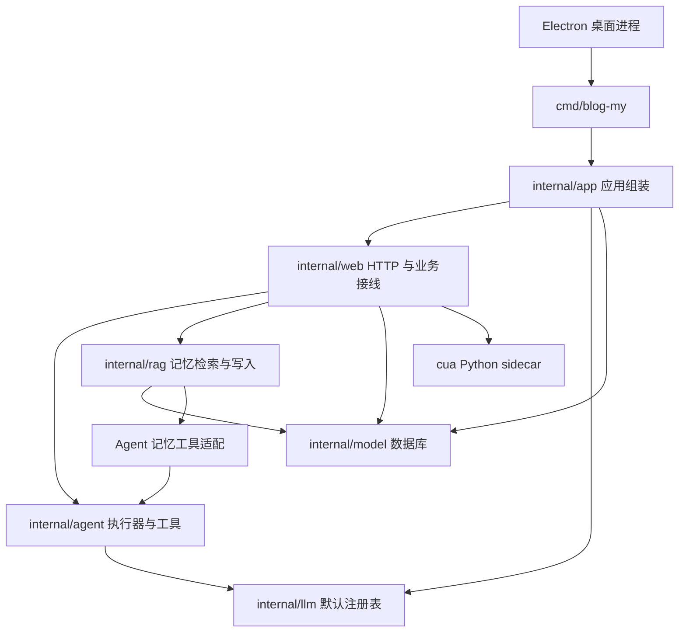

# 项目架构

更新：2026-10-19。后端使用 Go 官方服务项目布局中的 `cmd/` + `internal/`，不把应用内部代码当成公共 SDK 发布。依据：https://go.dev/doc/modules/layout。

## 入口与依赖

`cmd/blog-my/main.go` 只负责进程信号与错误退出。`internal/app.Run(ctx)` 完成环境、数据库、模型注册、路由与监听的组装，并负责关闭服务和数据库。HTTP 退出会取消流式请求；主动聊天调度随应用启动和取消，不再在导入包时启动。

`cmd/skillimport` 是独立命令，共享内部数据模型。模型默认注册集中在 `internal/llm/defaults.go`，生产入口无需重复列举供应商。

## 聊天与执行数据流

1. Electron 加载本地用户配置，启动后端，解析 `READY <url>` 后显示页面。
2. `internal/web/chat.go` 处理用户、会话、模型与请求参数。
3. HTTP 层解析会话用途、执行模式、工作区和助手设定，组装人格、用户画像与相关记忆。
4. 普通聊天进入模型适配；工具聊天进入 `internal/agent` 的 Eino 或 legacy 执行器。
5. 执行器产生工具调用，经 HTTP 权限包装器与工具自身校验后执行，结果回灌模型。
6. SSE 把文本、工具、等待输入与完成状态发送给页面，消息与轨迹写回 MySQL。
7. 自动记忆与画像逻辑在对话后运行；模型失败不能被当成画像刷新成功。

### 运行器 Module

Interface 是 `agent.Run` / `Config` / `Event`。Eino 和 legacy 是两个 Adapter，负责各自模型消息和流式协议。`tool_state.go` 集中保存一次运行及续行阶段间的重试、副作用不确定状态和修改后验证序号；`model_retry.go` 集中可取消等待。这样修改执行保护时只需改一处，测试通过两种 Adapter 验证行为。

引擎的图片、用户暂停、预算和事件转换继续由引擎负责。共享实现不改变工具调用与结果的配对要求，也不把模型服务错误隐藏为成功。

## 记忆与用户画像

| 概念 | 代码 | 数据 |
| --- | --- | --- |
| 原始文档、记忆、切块 | `internal/rag/ingest.go`、`store.go` | MySQL `kb_document`、`kb_chunk` |
| 语义/关键词/实体融合 | `store.go`、`hybrid.go` | 向量以 float32 编码存入 MySQL，检索在 Go 进程计算 |
| 重要性、活跃度、时间 | `dynamics.go` | 文档动力学字段及强化时间 |
| 自动记忆 | `internal/web/agent_memory.go` | 记忆文档与变更流水 |
| 用户画像 | `internal/web/agent_profile.go` | `kb_document.source = profile`，正文在 content |
| 人格、说话方式、做事方式 | `internal/web/soul.go`、`soul_evolve.go` | 全局 Agent 设置或当前助手配置 |
| 对话与工具轨迹 | `internal/web/chat.go`、`agent.go` | conversation、message |

检索限定用户或公共文档，并排除 stale 文档。查询分词与实体归一化每次请求只执行一次；候选元信息也只在请求内缓存，因此下一次请求能看到新记忆。每个块生成一条带完整 Scope 和动力学字段的候选。编码向量直接参与余弦计算，减少中间数组。

目前仍是读取可见候选后在进程中排序，随知识库扩大需另行基准评估，不能把本次微优化当成向量索引。画像与人格注入采用不同数据和优先级，画像不是人格配置。

## 目录与发布资源

- `internal/` 的包仅供本模块内部使用；包内测试与源码相邻。
- `templates/` 的地址和资源布局保持与打包协议一致，避免静态资源迁移破坏运行。
- `examples/mock-web/` 是独立 Node mock 示例；`examples/cloudbase/` 是云函数示例，均不参与桌面打包。
- `docs/archive/` 保存旧任务和过时快照；当前使用说明与历史证据分开。
- `artifacts/documents/` 保存用户文档和解析附件，不属于产品代码，也不进入 Git。
- `bin/`、`build/`、`dist/` 为生成目录。历史根目录缓存被忽略；没有删除用户文档或数据库。

## 检查与恢复

命令见根 [README](../README.md)。`npm test` 默认模拟模型并跳过真实数据库，`npm run check` 运行工具链和 Go vet。需要真实 MySQL 时显式启用，并指定专用库。

迁移前源码备份在 `build/refactor/snapshots/2026-10-19-before-layout.zip`，迁移清单在 `build/refactor/layout-moves.json`。该备份不包含 `.env`、用户数据库、缓存和运行数据；只用于本轮代码对照，不是完整数据备份。恢复需按清单逐项比较，不能直接覆盖后续工作。

当前布局决策见 [ADR-0001](adr/0001-application-layout.md)。

2026-10-21 增补：工具发现、权限装配和经验学习统一流程见 [ADR-0002](adr/0002-agent-capability-assembly.md)。主会话、子会话和确认重放共用 `internal/web/hermes_runtime.go`；机制实现分别放在 `internal/agent/toolsys`、`evolve`、`mcps`，不再从 HTTP handler 直接维护另一套工具权限。
