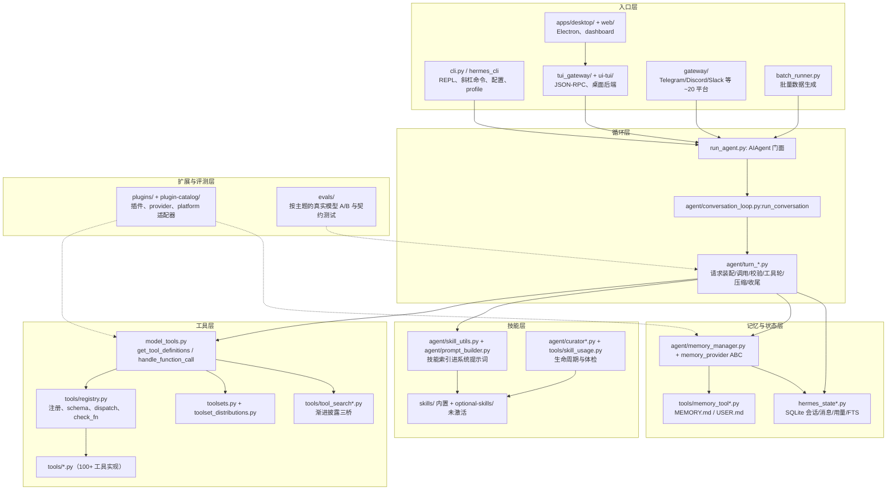

# 00 Hermes 分层结构与能力差距

> 参考快照：`references/hermes-agent-main/`（NousResearch/hermes-agent 主分支，只读）。
> 本文所有结论均来自源码或该仓库自带的 `AGENTS.md`；引用格式 `路径:符号`，路径相对 `references/hermes-agent-main/`。
> 未在源码中出现的机制会显式标注「未在源码中找到」。

## 1. 分层图

Hermes 不是「一个 agent 包」，而是**窄核心 + 一堆并列入口**：核心只负责「一轮对话怎么转」，其余能力（工具、技能、记忆、插件、多平台）都挂在核心外侧。根 `AGENTS.md` 把这条写成了两条不变量：提示词缓存前缀神圣（除上下文压缩外不许中途改系统提示词/工具集/记忆），核心是窄腰（新能力优先做成 CLI+skill / service-gated tool / plugin，而不是核心工具）。

### 1.1 每层的职责与入口

| 层 | 职责 | 关键文件与入口 |
|---|---|---|
| 入口 | 把「人/平台消息」变成一次 `run_conversation` | `cli.py:HermesCLI`、`hermes_cli/commands.py:COMMAND_REGISTRY`、`gateway/run.py`、`tui_gateway/`、`apps/desktop/`、`batch_runner.py` |
| 循环 | 一轮的每个阶段各占一个 sibling 文件：预检→请求装配→API 调用→响应接收→工具轮→压缩→收尾 | `agent/conversation_loop.py:run_conversation`；`agent/turn_preflight*`、`turn_request_assembly`、`turn_api_call`、`turn_response_intake`、`turn_tool_round`/`turn_tool_validation`、`turn_context_compaction`、`turn_finalizer`（`agent/AGENTS.md`） |
| 工具 | 注册 → 按 toolset 解析出「本轮可见工具」→ schema 净化 → 由模型调用 → registry 分发 | `tools/registry.py:ToolRegistry.register/get_definitions/dispatch`、`model_tools.py:get_tool_definitions`、`toolsets.py:TOOLSETS`、`tools/tool_search.py:assemble_tool_defs` |
| 技能 | `SKILL.md` 进系统提示词的**索引**（不是全文），正文按需 `skill_view`；后台 curator 管生命周期 | `agent/skill_utils.py:parse_frontmatter`、`agent/prompt_builder.py`（技能索引 + `.skills_prompt_snapshot.json`）、`tools/skill_manager_tool.py`、`tools/skills_tool.py`、`agent/curator.py` |
| 记忆/状态 | 两类记忆：常驻的 `MEMORY.md`/`USER.md`（冻结快照进系统提示词）+ provider 插件（RAG 等）；会话本身落 SQLite | `tools/memory_tool*.py`、`agent/memory_manager.py`、`hermes_state.py` 门面与 `hermes_state_*.py` 兄弟文件 |
| 扩展 | 插件不得改核心；工具/钩子/CLI 子命令/provider 全部走 `ctx` 与 ABC | `plugins/AGENTS.md`、`hermes_cli/plugins.py:PluginManager`、`plugin-catalog/*.yaml` |
| 评测 | 每个 eval 目录自带 README/runner；主张「行为契约测试，不做 change-detector」 | `evals/tool_search/README.md`、`evals/toolperf_abeval/README.md`、`evals/compaction/`、`evals/prefix_rediet/` 等 |

### 1.2 与 Moon Agent 的结构差异（一句话版）

Moon 是「一个 Go 进程 + 一个平铺工具表 + MySQL 技能库」；Hermes 是「多入口 + 声明式 toolset + 注册表 + 技能/记忆/插件/状态四个可插拔子系统」。差距不在模型能力，而在**编排层缺少「目录/注册/生命周期」这三样东西**：Moon 的 `buildAgentTools` 是命令式 append（`internal/web/agent_tool_policy.go:35`），Hermes 的 `TOOLSETS` 是数据（`toolsets.py:74`）；Moon 的循环每轮从 `ToolSource.Defs()` 取定义（`internal/agent/loop.go:185`），但默认实现就是全量注册表（`internal/agent/tool.go:156`），没有「可见集 ≠ 全量集」的概念。

## 2. 能力差距矩阵

| 能力 | Hermes 实现（源码坐标） | Moon 现状（Go 坐标） | 本轮对应 | 差距 |
|---|---|---|---|---|
| 工具编组 | `toolsets.py:TOOLSETS` / `_HERMES_CORE_TOOLS`（51 个名字）/ `resolve_toolset` | `internal/web/agent_tool_policy.go:buildAgentTools` 命令式 append | `toolsys.Toolset` + `NewCatalog` | 中：改成声明式，但无 per-platform bundle |
| 工具发现 | `tools/tool_search.py:assemble_tool_defs` + `tools/tool_search_catalog.py:search_catalog`（BM25） | 全量塞进请求（`internal/agent/tool.go:156`） | `Catalog` + `tool_search` | 大：检索算法、桥接工具、预算降级都不同 |
| 参数健壮性 | `tools/schema_sanitizer.py:sanitize_tool_schemas`、`tools/arg_coercion.py:coerce_tool_args`、`tools/tool_search_validation.py:validate_deferred_call_args` | 各工具自己 `json.Unmarshal`（`internal/agent/tool.go:24` 注释即契约） | `Sanitize`/`Coerce`/`Validate` 装饰器 | 中：思路一致，缺 schema 驱动的统一层 |
| 大结果 | `tools/tool_result_storage.py:maybe_persist_tool_result`、`tools/budget_config.py:DEFAULT_RESULT_SIZE_CHARS=100000`、`tools/tool_output_truncate.py:truncate_head_tail` | 出口硬截断 16000 字符（`internal/agent/guard.go:34,49`），**内容丢失** | `SpillPolicy.Wrap` + `read_tool_result` | 大：从「丢」变「落盘可回读」 |
| 并行 | `agent/tool_dispatch_helpers.py:_plan_tool_batch_segments`、`agent/tool_executor.py:execute_tool_calls_segmented` | 严格串行（`internal/agent/loop.go:230` 逐条执行） | `toolsys.Plan`/`RunBatch` | 大：Hermes 还做路径冲突切段，我们本轮只按 Risk 分批 |
| 审批 | 命令内容级：`tools/approval.py:check_all_command_guards`、`tools/approval_floors.py`（hardline/deny/allowlist 先于 bypass）、`tools/approval_context.py:_VALID_MODES=("manual","smart","off")` | 工具名级：`internal/web/agent_confirm.go:riskyTool` + `agent_tool_policy.go:93-99` 包 `confirmTool` | `toolsys.Risk` 决定是否可并行/是否需确认 | 大且**方向不同**（见 01 §8） |
| 技能生命周期 | `tools/skill_manager_tool.py`（create/patch/write_file/remove_file/delete）+ `tools/skill_usage.py`（`.usage.json`）+ `agent/curator.py`（stale/archive/LLM 合并） | `internal/web/skill_write.go`（模型可写）+ `internal/web/skill.go`（`skill_search`/`skill_read`），**无使用度量、无体检、无归档** | `evolve.Ledger` + `Curator` | 大 |
| 记忆 | `tools/memory_tool_store.py:MemoryStore`（MEMORY.md/USER.md，2200/1375 字符预算，`§` 分隔）+ provider 插件 | `internal/web/kb.go:kbMemoryTools`（RAG 检索 + 写入），无结构化条目 | `evolve.MemoryFile` + `memory_*` 工具 | 中：两套并存，不是替代 |
| 轨迹/评测 | `agent/trajectory.py:save_trajectory`（JSONL+flock）、`trajectory_compressor.py`、`evals/toolperf_abeval`（轨迹指标 A/B） | 无运行轨迹、无评测 | `evolve.Recorder` + `Score` | 大 |
| 自模型 | `SOUL.md`（人格文本）+ `agent/runtime_self_protection.py`（运行时不删自身） | `internal/web/soul_evolve.go:29`（模型可改人格特质）+ `internal/web/agent.go:250` 人格成长提示 | 保持现状，仅补证据链要求 | 小：Moon 反而更激进 |

矩阵里「差距」列的含义：**大** = 本轮只能做简化版、后续还要补；**中** = 结构对齐、算法可降级；**小** = 本轮不动。

## 3. 本轮落地范围

本轮只做两件事，且都必须默认关闭、关掉后与改造前逐字节等价（契约 §1.1）：

1. **A 包 `internal/agent/toolsys`**：把平铺工具表升级成「声明式 Catalog + 可选渐进披露 + 参数净化/纠偏/预校验 + 大结果落盘 + 只读并行」。逐机制对照见 [01-tool-calling.md](01-tool-calling.md)。
2. **B 包 `internal/agent/evolve`**：把 `skill_write`/`soul_evolve` 的单点写入升级成「使用账本 + 体检 + 去重 + 轨迹 + 确定性 curator + 轨迹回放评分」。逐机制对照见 [02-self-evolution.md](02-self-evolution.md)。

两篇文档都按四段式写：**hermes 的做法（引用）→ 关键算法/伪代码 → 我们的 Go 对应实现 → 差异与风险**。

## 4. 本轮明确不做的清单（附理由）

以下能力在 Hermes 里是真实存在的，但**本轮不实现**，原因是「没有对应写域 / 依赖 Moon 没有的基础设施 / 收益不足以抵消兼容风险」：

| 不做的事 | Hermes 位置 | 不做的理由 |
|---|---|---|
| MCP 工具发现与远程目录（`tool_describe`/connector 网关） | `tools/mcp_tool_*.py`、`tools/connectors/`、`tools/tool_search.py:dispatch_tool_describe` | **部分已做**：MCP 客户端（stdio 传输、工具发现/调用）已落地，见 `03-mcp.md`；`tool_describe` 第二桥接与 HTTP 传输仍未做 |
| BM25 + Snowball 词干化检索 | `tools/tool_search_catalog.py:_bm25_score/_stem` | 中文场景词干化收益低；本轮用「精确/前缀/别名/描述」四档打分，确定性更好测 |
| listing 预算降级（full→names→groups，tier 1/2） | `tools/tool_search.py:assemble_tool_defs`、`tool_search_catalog.py:build_catalog_listing_with_form` | 我们本轮只暴露 ≤30 个工具，没有「3000 工具 API」的量级问题 |
| 按路径冲突切并行段（读读并行、写写串行） | `agent/tool_dispatch_helpers.py:_plan_tool_batch_segments` | 本轮 Plan 只按 Risk 分批；路径级冲突留到后续（见 §5） |
| per-turn 结果总预算（200k 字符）+ 逐个大结果淘汰 | `tools/tool_result_storage.py:enforce_turn_budget` | Moon 单轮工具调用上限更小，单条落盘足够；预算层留到有真实撑爆案例再加 |
| 审批的 guardian LLM（smart 档）与拒绝熔断 | `tools/approval_smart.py:_smart_verdict`、`tools/approval.py:_denial_tally/_record_denial` | Moon 是「工具名 + 前端确认」模型；引入第二模型判断越权风险，收益不明 |
| curator 的 LLM fork（合并/改名/跨技能重写 cron 引用） | `agent/curator.py:run_curator_review`、`_rewrite_cron_refs` | 本轮 curator 必须是确定性、可幂等重跑的；LLM 合并留到 suggest 档之后 |
| 技能归档目录 + 逐次变更账本 + 回滚 | `tools/skill_usage.py:archive_skill/restore_skill`、`tools/skill_ledger.py` | Moon 技能在 MySQL（契约 §1.7 不加迁移）；文件化归档需要先决定存哪 |
| 后台 review 线程（每轮后 fork 判断要不要存技能/记忆） | `agent/background_review.py` | Moon 是同步 HTTP 请求生命周期，没有安全的「轮后线程」；改为「轨迹落盘 + 离线 Curator」 |
| SQLite 会话状态库 / FTS 检索 / 用量定价 | `hermes_state*.py`、`agent/insights.py` | Moon 已有 MySQL 会话与 RAG；重复建库违反「能落文件就不动表」 |
| 多平台 gateway、桌面/TUI 双端、profile 多租户 | `gateway/`、`tui_gateway/`、`hermes_cli/` profiles | 与工具/进化无关，属另一条产品线 |
| 技能 Hub 安装（GitHub/clawhub/官方 optional-skills） | `tools/skills_hub_*.py`、`optional-skills/` | Moon 技能来自自有库；外部安装涉及供应链安全，单独立项 |

## 5. 后续可做清单（按收益/成本排序）

1. **并行按路径切段**：`Plan` 增加「写工具与同路径读写互斥」判定，直接搬 `_plan_tool_batch_segments` 的规则；Moon 的 `agent.Exec.Root` 已经有沙箱根，路径可比。
2. **per-turn 结果预算**：等 `AGENT_TOOL_SPILL_BYTES` 上线后观察真实轮次大小，再决定是否引入 `enforce_turn_budget` 式的总预算。
3. **MCP 第二桥接 `tool_describe`**：客户端已落地（`internal/agent/mcps`、`03-mcp.md`），但工具数少时盲调代价不大；等外部工具过百再加「先看 schema 再调」，否则失败率会抵消渐进披露的收益。HTTP/SSE 传输同理，按需再实现 `Transport`。
4. **技能文件化**：把技能从 MySQL 迁到 `skills/<name>/SKILL.md` + `.usage.json` 旁车，才能做归档、账本、回滚（Hermes 的整套 curator 都建立在文件树上）。
5. **后台离线 curator**：用已有轨迹 + 账本跑「suggest 档」报告，人工确认后再 `apply`；等报告稳定再考虑 LLM 合并。
6. **评测集**：把 `evals/toolperf_abeval` 的「陷阱任务」思路搬成 Moon 的 `evals/` 用例（弱模型才是信号源，强模型多数能自愈）。
7. **审批内容级检测**：给 `run_command`/`exec` 类工具加危险模式检测与不可绕过的 deny 规则，向 Hermes 的 `approval_floors` 靠拢。

## 6. 怎么核对本文

- 找符号：`grep -rn "def assemble_tool_defs" references/hermes-agent-main/tools/`；Python 侧每个文件顶部 docstring 都写了不变量，先读 docstring 再读函数。
- Hermes 的「god file 已拆 sibling」：`model_tools.py`、`hermes_state.py`、`run_agent.py` 都只是门面，行为在同名 `_<topic>.py` 里；按主题 grep 而不是通读。
- Moon 侧：`internal/agent/tool.go`（接口与注册表）、`internal/agent/loop.go`（循环与工具执行）、`internal/agent/guard.go`（截断/压缩/预算）、`internal/web/agent_tool_policy.go`（工具装配）。
