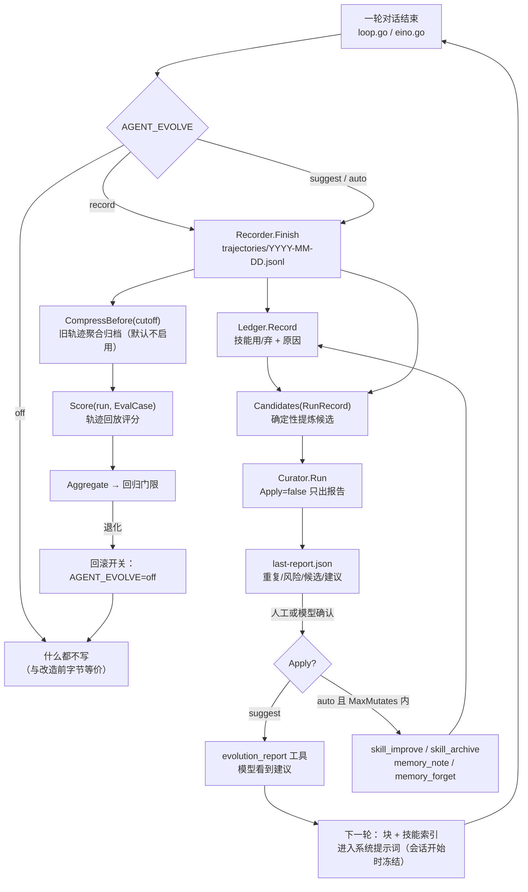

# 02 自进化：Hermes 逐机制对照

> 路径相对 `references/hermes-agent-main/`。四段式：**Hermes 做法（引用）→ 关键算法 → 我们的 Go 对应实现（契约 §4）→ 差异与风险**。
> Go 侧新包 = `internal/agent/evolve`；接线 = `internal/web/evolve.go`、系统提示词与工具注册。

先给结论：Hermes 的「自进化」不是模型自己改自己，而是**四条互相独立的回路**——技能文件的生命周期、记忆的双层结构、轮后的 LLM 复盘、离线评测。四条回路共用一个前提：所有状态都在磁盘上（`SKILL.md`/`.usage.json`/`MEMORY.md`/JSONL），所以可读、可 diff、可回滚、可被 cron 复查。Moon 现在只有「模型直接写技能」这一个写入点（`internal/web/skill_write.go`），缺的是**度量、体检、归档、轨迹**这四层，本轮补的正是这四层。

## 1. 技能：文件格式与索引

### 1.1 Hermes 做法

- 技能 = 一个目录 + `SKILL.md`（YAML frontmatter + markdown 正文）。frontmatter 的 `name`/`description` 是**索引的全部**，正文只有 `skill_view` 时才进上下文（`skills/AGENTS.md`；解析在 `agent/skill_utils.py:parse_frontmatter`）。
- 进系统提示词的是索引，不是正文：`agent/prompt_builder.py` 的 `build_skills_system_prompt` 扫技能目录 → 按 category 分组 → `_render_skills_index` 渲染成可用技能清单，每条形如 `- name: description`。
- 描述硬截断 60 字符：`agent/skill_utils.py:SKILL_PROMPT_DESC_LIMIT = 60`，`extract_skill_description` 超过就截成 `前 57 字 + "..."`；作者规范（`skills/AGENTS.md`）要求正文式描述 ≤ 60 字符，就是为了这一步不丢信息。
- 索引有进程内缓存（`_SKILLS_PROMPT_CACHE`，上限 `_SKILLS_PROMPT_CACHE_MAX = 32`，按 profile 的 skills_dir 分键）和磁盘快照（`~/.hermes/.skills_prompt_snapshot.json`，`_SKILLS_SNAPSHOT_VERSION = 4`，含 manifest + 每条的 `rel` 路径），避免每次会话都全盘扫描。
- 关键不变量：**技能内容变化不得中途改系统提示词**。所以 `/skill` 斜杠命令注入的是 user message（`agent/skill_commands.py`，根 `AGENTS.md` 明确要求），不是重建系统提示词。

### 1.2 关键算法（简化）

```
def skills_blocks(home):
    entries = scan(skills_dirs)                    # 每个 SKILL.md 只读 frontmatter
    for e in entries: e.desc = e.desc[:57] + "..." if len>60
    return render(group_by_category(entries))      # 缓存 + 快照，避免重复扫描
```

### 1.3 我们的 Go 对应

- 现状：`internal/web/skill.go:skillPromptBlock`（第 208 行）从 MySQL 只查 `id,name,description`，前 `skillPromptLimit` 条带简介（`clipRunes(desc,160)`），其余**只列名字**，最后一句「当前共 N 个已启用技能」；正文靠 `skill_read` 取（`skill_search` 负责找）。
- 与 Hermes 的对应关系：`skillPromptBlock` ≈ `_render_skills_index`；`skill_search`/`skill_read` ≈ `skills_list`/`skill_view`；差别是 Moon 多一层「名字只列表」的降级（因为技能存在 DB，可能上千条），Hermes 靠 category 分组 + 60 字符控制总量。
- 本轮不动技能存储（契约 §1：不加 DB 迁移），只把「使用度量 + 体检结果」挂在 `evolve.Ledger` 与 `Lint` 上，供 `skill_list`/`skill_stats` 工具读。

### 1.4 差异与风险

- Hermes 技能是**文件**，所以能进 git、能 diff、能被 curator 直接改；Moon 是 DB 行，改技能只能整段覆盖。本轮不做迁移，但要在文档/工具文案里明确「`skill_improve` 先读旧正文再改」，避免模型盲写覆盖（Hermes 的 `skill_manage(action="patch")` 就是为此存在，`old_string`/`new_string` 语义）。
- 风险：`skillPromptBlock` 的 160 rune 截断与 Hermes 的 60 字符不同——描述里若把「何时使用」写在末尾会被截掉。建议后续对齐：描述前 60 字符必须自解释。

## 2. 技能生命周期

### 2.1 Hermes 做法

**创建/改写**：唯一入口 `skill_manage`（`tools/skill_manager_tool.py`），一个调用 = 一个 `operations` 数组，分支 `anyOf` 由 `_op_schema` 生成：`create`（content+category）、`patch`（old_string/new_string/replace_all/file_path）、`patch`（整篇 content 重写，最后手段）、`write_file`、`remove_file`、`delete`（`absorbed_into` 仅 curator 合并用）。校验与限额：

- `_validate_frontmatter`（第 146 行）：`MAX_NAME_LENGTH=64`、`MAX_DESCRIPTION_LENGTH=1024`、`VALID_NAME_RE`。
- `_validate_content_size`（第 182 行）：`MAX_SKILL_CONTENT_CHARS=100_000`、`MAX_SKILL_FILE_BYTES=1_048_576`；允许的子目录 `ALLOWED_SUBDIRS={references,templates,scripts,assets}`。
- 安全：`skills_guard.scan_skill` 扫正文；被 pin 的技能、后台 review 的写入都有独立 guard（`skill_manager_guards`）。
- 每个 action 一个 schema 分支且 `additionalProperties:false`——源码注释写明原因：扁平 union 下小模型会把 `file_content` 混进 `create` 导致整批回滚（issue #112677）。

**使用度量**：旁车文件 `~/.hermes/skills/.usage.json`（`tools/skill_usage.py`），跨进程 flock/msvcrt 锁，原子写。每条 `_empty_record`（第 348 行）含 `created_by`、`use_count`、`view_count`、`last_used_at`、`last_viewed_at`、`patch_count`、`patch_generation`、`created_at`、`state`、`pinned`、`archived_at`、`first_seen_at`。计数器入口全部集中：`bump_use`/`bump_view`/`bump_patch`/`record_created`/`record_installed`/`mark_agent_created`/`set_state`；`created_by` 是生命周期分界线——`"agent"` 才归 curator 管，`"learn"`（`/learn` 建的）与内置技能不在管辖内（`PROTECTED_BUILTIN_SKILLS`）。

**体检**：`tools/skill_linter.py:lint_content/lint_skill` 只产出建议（`LintFinding(severity, rule, message)`，ERROR/WARNING，不阻塞）。规则是一张表，不是一段 if：`_SHELL_UTIL_TO_TOOL`（`grep`→`search_files` 等「该用工具而不是命令」）、`_MARKETING_WORDS`、`_POSIX_PRIMITIVES`、`_FORBIDDEN_FILES=(README.md, CHANGELOG.md, install.sh, .env, ...)`、`_INCIDENT_REF_MIN=4`、`_MAX_REFERENCE_FILES=60`、`_BODY_SOFT_BUDGET_CHARS=24_000`。

**自动流转**：`agent/curator.py`。默认 `DEFAULT_INTERVAL_HOURS=168`（7 天一次）、`DEFAULT_MIN_IDLE_HOURS=2`、`DEFAULT_STALE_AFTER_DAYS=14`、`DEFAULT_ARCHIVE_AFTER_DAYS=30`、`DEFAULT_CONSOLIDATE=False`；状态文件 `.curator_state`。`should_run_now`（第 160 行）第一次观察只**播种时间戳然后推迟一个周期**，避免装完就立刻扫；`apply_automatic_transitions`（第 209 行）按「活动锚点」做 active→stale→archived 的确定性迁移，`_archive_as_curator`（第 194 行）只把目录移到 `.archive/`，**永不删除**（`skills/AGENTS.md` 的硬规则：不删、pinned 豁免、只动 `created_by:"agent"`）。

**LLM 合并**（可选，`DEFAULT_CONSOLIDATE=False`）：`CURATOR_REVIEW_PROMPT`（第 290 行）要求「建类级总纲、把多个窄技能吸收成一个 umbrella、正文目标 ≤24k」，并列出硬规则（不碰 bundled/hub/external、不删、跳过 pinned、跳过被 cron 引用的技能、按内容判断而不是计数器）；执行在 `run_curator_review`（第 915 行）→ `_run_llm_review`（第 1085 行，用 auxiliary 模型，且 `_memory_nudge_interval=0` 关闭子 agent 的自我提醒）；单次跑用 `O_EXCL` 抢占（`_claim_run`，`_CLAIM_STALE_SECONDS=3600`）；`maybe_run_curator`（第 1198 行）受 idle 门控。

**留痕**：`tools/skill_ledger.py` 每次变更追加一行到 `~/.hermes/skills/.curator_ledger.jsonl`，内容按 sha256 存 `~/.hermes/.curator_backups/blobs/`；同文件 docstring 写明「TELEMETRY, NOT A GATE：所有写入路径都吞异常记日志，只有 rollback 的 capture 失败会 fail closed」。

### 2.2 关键算法（简化）

```
# 每天/每次空闲
if should_run_now(state) and idle >= min_idle:
    for s in skills where created_by == "agent" and not pinned:
        if days_since(activity(s)) > 30: archive(s)        # 只移动，不删除
    if consolidate:                                         # 可选
        llm_review(claim_lock, prompt=umbrella_consolidation)
    report = {...}; write(.curator_state); ledger.append(...)
```

### 2.3 我们的 Go 对应（契约 §4）

```go
type SkillUse struct { Name string; OK bool; Reason string; At time.Time }
type Ledger struct { Path string }
func (l *Ledger) Record(u SkillUse) error
func (l *Ledger) Stats() ([]SkillStat, error)
func (l *Ledger) AtRisk(minUses int, limit int) ([]SkillStat, error)  // 失败率高或久未使用

type Issue struct { Code, Message string; Severity string }           // warning | error
func Lint(it SkillItem) []Issue
func Duplicates(items []SkillItem, threshold float64) [][2]string     // jaccard
func Dangerous(body string) []Issue

type Curator struct { Store SkillStore; Ledger *Ledger; Recorder *Recorder; Apply bool; MaxMutates int }
func (c *Curator) Run(ctx context.Context, userID string) (Report, error)
func (c *Curator) LastReport(dir string) (Report, bool, error)        // Dir/last-report.json
```
- 工具面（契约 §4.1）：`skill_list`/`skill_stats`/`skill_lint`/`skill_improve`/`skill_archive`。`skill_improve` 必须「先读旧正文再改，写前先 lint」——对应 Hermes 的 `patch` action 而非整篇重写。
- 接线：`internal/web/evolve.go` 按 `AGENT_EVOLVE=off|record|suggest|auto` 装配；`off` 时所有工具与钩子都不注册（契约 §1.1 的字节等价红线）。
- `Apply=false` 必须**只读不改**、可重复调用结果一致（契约 §7）；`MaxMutates` 默认 3 是「一次固化最多改几条」的安全阀。

### 2.4 差异与风险

| 点 | Hermes | 我们 | 风险/对策 |
|---|---|---|---|
| 存储 | 文件树 + 旁车 JSON | MySQL + JSONL 账本 | 无法 `git diff` 技能；`skill_improve` 必须走 patch 语义 |
| 度量 | `.usage.json` 原子写 + 跨进程锁 | 账本 JSONL 追加 | 并发追加要加文件锁（`fs` 层已有原子追加约定）；统计用 `Stats()` 全量聚合，别在热路径调 |
| 体检 | 建议式 linter（不阻塞），规则表驱动 | `Lint` 返回 `[]Issue`，`AGENT_SKILL_LINT=warn` 只打日志 | `block` 档不能拦「读取/使用」旧技能，只能拦写入 |
| 归档 | 移到 `.archive/`，可 `restore_skill` | `skill_archive` 置 `enabled=false`（不删） | 必须能恢复；「不删」是硬约束 |
| 合并 | 可选 LLM fork，有硬规则 + absorbed_into | 本轮不做 | 没有 LLM 合并时，`Duplicates` 报告 + 人工/工具确认就够 |
| 幂等 | `.curator_state` + O_EXCL claim | `Report` 落盘 + `Curator.Run` 幂等 | 同一输入两次 `Run(Apply=false)` 必须产出同序同内容的 `Report`（契约 §7 的验收点） |

## 3. 记忆分层

### 3.1 Hermes 做法

- **两层**：① 常驻的 `MEMORY.md`（agent 自己的笔记）与 `USER.md`（用户画像），由 `tools/memory_tool.py` 的**单个** `memory` 工具维护（action: add/patch/remove/batch）；② 外部 memory provider（RAG、honcho 等），由 `agent/memory_manager.py` 编排。
- **冻结快照**：两个 `MEMORY.md`/`USER.md` 在会话开始被载入系统提示词，之后**本会话内不再重载**（根 `AGENTS.md` 的缓存不变量）；写入只影响下一个会话。
- 字符预算：`memory_char_limit=2200`、`user_char_limit=1375`（`load_on_disk_store` 的默认值），超限直接报错（`MemoryStore._over_limit`），不是静默截断。
- 结构：段落头 `MEMORY_BLOCK_HEADERS`，条目分隔符 `ENTRY_DELIMITER="\n§\n"`（`tools/memory_tool_store.py`）。
- 写入安全：`_scan_memory_content` 扫描注入/越权指令；`.bak` + 漂移守卫——发现文件被外部改过就拒绝写入，避免丢掉用户手写的自由文本区；`old_text` 匹配做排版折叠（`_normalize_for_match`/`_find_unique_match`），要求唯一命中，否则报「多处命中，请给更多上下文」。
- 编排（`agent/memory_manager.py`）：内置 store 永远可用，外部 provider **同时只允许一个**；有卡死调用闸门（`_MAX_STUCK_CALLS=4`、`_PROBE_INTERVAL_S=60`、`_MAX_INFLIGHT_CALLS=16`）；provider 的后台线程必须走 `spawn_context_thread`（拷贝 contextvars），不能裸 `threading.Thread`。

### 3.2 关键算法（简化）

```
def memory(action, target, text):
    store = MEMORY.md if target=="memory" else USER.md
    if action in write_actions and len(store)+len(text) > limit: return over_limit_error
    if scan(text).suspicious: return refuse
    if drift_detected(store): return refuse_with_backup_hint
    patch: require unique normalized match, else error
    write atomically; next session re-snapshots
```

### 3.3 我们的 Go 对应

```go
type MemoryEntry struct { ID, Topic, Text string; CreatedAt, UpdatedAt time.Time; Hits int }
type MemoryFile struct { Path string; MaxEntries int; MaxRunes int }   // 默认 200 条 / 8000 字
func (m *MemoryFile) Add(topic, text string) (created bool, err error) // 规范化后相同视为重复
func (m *MemoryFile) Search(query string, limit int) []MemoryEntry
func (m *MemoryFile) Remove(id string) (bool, error)
func (m *MemoryFile) Block() string                                     // 注入提示词的 <memory> 块，空则不注入
```
- 现状：Moon 已有 RAG（`internal/web/kb.go:kbMemoryTools`，`memory_search`/`memory_write`）。本轮**不替代 RAG**，而是加一个「结构化、可去重、可遗忘、有上限」的旁路：RAG 管「翻旧账」，`MemoryFile` 管「每次都要记得的少数事实」。
- 注入位置：系统提示词追加 `<memory>` 块（契约 §5），与 `skillPromptBlock` 并列；为空时**不得**输出空标签（否则每次请求都变）。
- 与 Hermes 的差异：Hermes 是冻结快照（本会话不更新）；Moon 每轮重拼系统提示词会破坏前缀缓存——本轮按「会话开始读一次、写只落盘」实现，等价于 Hermes 的冻结语义。

### 3.4 差异与风险

- 风险：`<memory>` 块进系统提示词 = 直接改变请求字节。必须默认关闭（`AGENT_EVOLVE=off` 时不注入），且块内容排序稳定（按 topic + id）。
- 风险：去重只做规范化（空格/全半角/大小写）就会漏同义重复；Hermes 的做法是「让模型自己 patch 而不是追加」（`memory` 工具的 add/patch/remove 三态）。我们的 `Add` 返回 `created=false` 时要在工具文案里告诉模型「已存在，用 `memory_forget` 或改写 topic」。
- 风险：`Block()` 超预算时截断策略要和 Hermes 的「报错不截断」区分开——工具写入时报错，`Block()` 渲染时按「最近更新优先」截断到 `MaxRunes`，并留一行「（已省略 N 条，用 memory_list 查看）」。

## 4. 从运行中提炼：三条触发路径

### 4.1 Hermes 做法

1. **轮后 LLM 复盘**（主力）：`agent/background_review.py` 在每轮结束后可能派生一个**后台 daemon 线程**，fork 一个 `AIAgent` 重放本会话，问「有没有该存的技能/记忆」。三条硬约束：写入通过工具白名单（dispatch 侧限制），绝不改主会话的提示词缓存，`_BackgroundReviewRun` 有取消握手；review agent 自己的 `_memory_nudge_interval = _skill_nudge_interval = 0`（防止复盘再触发复盘）。
2. **计数器催促**：`agent/agent_init.py:1304/1388` 设 `_memory_nudge_interval=10`、`_skill_nudge_interval=10`（可被 `memory.nudge_interval`、`agent.skills.creation_nudge_interval` 覆盖）；`agent/turn_context.py:_tick_memory_nudge` 每 10 轮把提醒塞进上下文，`agent/turn_iteration_prep.py:166` 在达到阈值且 `skill_manage` 可用时提醒「该考虑存技能了」。这是纯提示，不写盘。
3. **显式 `/learn`**：`agent/learn_prompt.py` 的 `_AUTHORING_STANDARDS`（frontmatter、描述 ≤60、章节结构）与 `_KNOWLEDGE_SKILL_STANDARDS`（精简 SKILL.md + 每章一个 `references/`，书→技能的拆法）；产出的技能 `created_by="learn"`，**不归 curator 管**。

配套可视化：`agent/learning_graph.py` 把技能与记忆做成图（`SkillNode`、`build_skill_nodes`、记忆节点 id `memory:<source>:<index>:<fingerprint>`，边来自 frontmatter 的 `related_skills` 与记忆↔技能的词汇重合），`agent/learning_mutations.py` 支持在图里直接改/删（删除技能 = 归档，改记忆要在 `MemoryStore` 锁内重读 + 漂移检查）；`agent/insights.py:InsightsEngine(db).generate(days=30)` 从 SQLite 聚合 token/成本/工具/技能活动（`_SKILL_TOOLS={skill_view, skill_manage}`）。

### 4.2 关键算法（简化）

```
after_turn(turn):
    if skill_nudge and iters_since_skill >= 10 and skill_manage available: inject_hint()
    if memory_nudge and turns_since_memory >= 10: inject_hint()
    spawn_daemon(review)                    # 写盘走工具白名单，不碰主上下文
```

### 4.3 我们的 Go 对应

```go
type Candidate struct { Kind string /* skill|memory|soul */; Name, Description, Body string; Evidence []string; Confidence float64 }
func Candidates(run RunRecord) []Candidate
```
- 提炼规则（契约 §4，确定性、可单测）：同一工具序列重复 ≥2 次且最终 ok → 技能候选；同工具失败 ≥2 次后成功 → 技能候选（记教训）；用户纠正/预算触顶 → memory 候选。**LLM 化留给接线层**，`Candidates` 是纯函数。
- 触发位置：`Recorder.Finish` 之后（离线）、`AGENT_EVOLVE=suggest|auto` 时由 `Curator.Run` 消费；不在 HTTP 请求线程里 fork（Moon 没有安全的「轮后线程」）。
- 与 `soul_evolve` 的关系：`internal/web/soul_evolve.go:29` 已经是「模型基于证据改人格」的通道（配套提示在 `internal/web/agent.go:250`），本轮把它当作 `Candidate.Kind=="soul"` 的证据来源之一，**不新增写人格的路径**。

### 4.4 差异与风险

| 点 | Hermes | 我们 | 风险 |
|---|---|---|---|
| 触发方式 | 每轮后 LLM 复盘（daemon） | 离线确定性规则 + 可选 LLM | 少一层「语义级洞察」；但可测、可复现 |
| 提醒 | 每 10 轮/10 次迭代注入提醒 | 不做（会破坏前缀缓存） | 模型主动存技能的概率下降；靠系统提示词里的「自进化使用须知」补 |
| 写入面 | 白名单工具 + guard | 现有 `skill_write`/`memory_note` | 必须保证 `AGENT_EVOLVE=off` 时这些工具**不存在**，而不是「存在但不写」 |
| 证据 | 对话重放 | `RunRecord.ToolCalls` + `Note` | 轨迹必须记 `OK/IsError/Summary`，否则提炼规则无从判断 |

## 5. 轨迹与上下文压缩

### 5.1 Hermes 做法

- **轨迹**：`agent/trajectory.py:save_trajectory` 把一次对话落成 ShareGPT 格式 JSONL，整文件 flock/msvcrt 锁后追加；完成的任务进 `trajectory_samples.jsonl`，中断/失败的进 `failed_trajectories.jsonl`。文件短（模块 56 行），因为格式简单才可靠。
- **在线压缩**：`agent/context_compressor.py`。默认阈值 50%（`_base_threshold_percent`），每模型可用 `model_thresholds` 覆盖（`resolve_model_threshold` 取最长匹配键），小窗口有**只升不降**的地板 `_SMALL_CTX_THRESHOLD_PERCENT=0.75`；保护头（system/首条 human/首条 gpt/首条 tool）与尾部 `protect_last_n`（默认 20）；先删旧工具结果（不调 LLM），再选边界，最后用 auxiliary 模型生成结构化摘要。失败有冷却，避免 provider 级联失败时反复压缩。
- **离线压缩**：`trajectory_compressor.py` 是独立脚本（Fire CLI，`--target_max_tokens`），保护头 + 最后 N 轮，只压中间且**不拆 tool_call/tool_response 对**——用于把历史轨迹变成可训练/可评测样本。

### 5.2 关键算法（简化）

```
if billed_tokens >= threshold:
    prune_old_tool_results()                  # 确定性，不调模型
    boundary = pick_boundary(protect_first, protect_last)
    summary = aux_model.summarize(middle)
    messages = head + [summary] + tail
```

### 5.3 我们的 Go 对应

```go
type RunRecord struct { RunMeta; ToolCalls []ToolCallRecord; Outcome, Note string; FinishedAt time.Time; Rounds, Tokens int }
func (r *Recorder) Start(meta RunMeta) *Run
func (run *Run) Tool(rec ToolCallRecord)
func (run *Run) Finish(outcome, note string) error   // 原子追加到 Dir/trajectories/YYYY-MM-DD.jsonl
func (r *Recorder) CompressBefore(cutoff time.Time) (CompressReport, error)
```
- 要求（契约 §4）：单行 JSON ≤32KB（超长 args/summary 截断并标记）、run 内加锁、**写失败不影响对话**（调用方降级，只打日志）。
- 现状：`internal/agent/guard.go` 已有循环内压缩（`midLoopCompactTokensDefault=24000`、`midLoopKeepTail=6`）和统一截断；本轮不重写压缩，只要求 `Recorder` 记录 `Rounds/Tokens/Outcome`，让压缩触发与结果可被离线复算。

### 5.4 差异与风险

- Hermes 单文件 + flock；我们按天分文件（`YYYY-MM-DD.jsonl`），并发写同一天仍需文件锁或单写者（`Recorder` 内部串行化即可，因为一个进程只装配一个 Recorder）。
- 风险：截断 `args` 会丢「模型为什么这么调」的证据；契约要求标记，`Score` 与 `Candidates` 都要能识别 `Truncated=true` 并降权。
- 风险：`CompressBefore` 是破坏性操作（把旧轨迹聚合成 archive）。必须默认不启用，且聚合后原文件改名而非删除。

## 6. 评测

### 6.1 Hermes 做法

- 每个主题一个目录，各自 README 说明「怎么跑、看什么指标」：
  - `evals/tool_search/README.md`：5 个活体场景（obvious_single / vague_paraphrased / multi_tool_chain / core_plus_deferred / no_tool_needed）× tool_search 开/关，记录 `bridge_calls` 与 `underlying_tool_calls`，用 `tool_search_livetest.py` 跑、`analyze_livetest.py` 分析。
  - `evals/toolperf_abeval/README.md`：两个 arm 只差一个环境变量（`PYTHONPATH`），9 个陷阱任务，成功与否由程序化检查判定，指标从 NeMo Relay ATOF trace 里算；`meta.jsonl` 断点续跑。实测 qwen3-coder-30b 上轮数 −21%、工具调用 −29%、墙钟 −23%。
- 方法论上的硬规定（根 `AGENTS.md`）：行为契约测试，**不做 change-detector**；E2E 用真实 import + 临时 `HERMES_HOME`；结论必须能指到「bug 出现的行」。

### 6.2 我们的 Go 对应

```go
type EvalCase struct { ID, Prompt string; WantTools []string; MaxFailRate float64 }
type EvalResult struct { Case EvalCase; Run RunRecord; Score float64; Notes []string }
func Score(run RunRecord, c EvalCase) float64   // 工具命中率/失败率/是否 aborted；确定性
func Aggregate(results []EvalResult) (mean float64, n int)
```
- 本轮定位：**轨迹回放打分**，不跑真模型、不连 MySQL（契约 §7：表驱动测试）。用例是「给定一条轨迹 + 期望工具集」，判「命中率是否达标、失败率是否超限、是否 aborted」。
- 与 Hermes 的差别：Hermes 用真模型 A/B 证明「改动的净收益」；我们只能用离线轨迹证明「行为没有退化」。两者互补：离线防回归，在线 A/B 证明收益。

### 6.3 差异与风险

- 风险：`Score` 只看工具名会奖励「乱调但名字对」的轨迹；必须同时看 `IsError` 与 `Outcome`（`limit`/`error` 直接扣分）。
- 风险：`MaxFailRate` 单门限容易全过或全挂；建议 `WantTools` 命中率与失败率**双门限**，任一不达标即 fail（对应契约 §7 的「负向用例」）。
- 不做：真实模型 A/B、trace 采集、成本核算。这些依赖 Hermes 才有的 NeMo Relay 基础设施。

## 7. 进化闭环（总图）



要点：**闭环的每一跳都可关**。`off` 断在第一步；`record` 只写轨迹不产生建议；`suggest` 出报告但不动技能；`auto` 才允许 `MaxMutates` 内的写入。任何一跳失败都不能影响对话本身（轨迹写失败只打日志，Curator 失败只留旧报告）。

## 8. 包/函数映射总表

| 契约 §4 条目 | Hermes 参照 | Go 落点 |
|---|---|---|
| `RunRecord` / `Recorder` | `agent/trajectory.py:save_trajectory` | `internal/agent/evolve/trajectory.go` |
| `Recorder.CompressBefore` | `trajectory_compressor.py`（离线压缩） | `trajectory.go:CompressBefore` |
| `SkillUse` / `Ledger` | `tools/skill_usage.py`（`.usage.json` + 计数器） | `evolve/ledger.go` |
| `Lint` / `Duplicates` / `Dangerous` | `tools/skill_linter.py:lint_skill` | `evolve/lint.go` |
| `Candidates` | `agent/background_review.py` + `agent/learn_prompt.py` | `evolve/candidates.go`（纯函数） |
| `Curator.Run` / `Report` | `agent/curator.py:apply_automatic_transitions` + `run_curator_review` | `evolve/curator.go` |
| `MemoryFile` | `tools/memory_tool_store.py:MemoryStore` | `evolve/memory.go` |
| `EvalCase` / `Score` / `Aggregate` | `evals/toolperf_abeval`（轨迹指标） | `evolve/eval.go` |
| 工具面（`skill_list`…`evolution_report`） | `tools/skills_tool.py` + `skill_manager_tool.py` + `memory_tool.py` | `internal/web/evolve_tools.go` |
| 装配与开关 | `hermes_cli/config_defaults.py`（`curator`/`skills`/`memory` 段） | `internal/web/evolve.go` |

## 9. 本轮不做

1. 技能从 MySQL 迁到文件树（`skills/<name>/SKILL.md`）——契约 §1 不加 DB 迁移。
2. 技能归档目录 + 逐次变更账本 + 单次回滚（`tools/skill_ledger.py` 那套）。
3. curator 的 LLM 合并 fork（umbrella 化、≤24k 正文、`absorbed_into`、跳过 cron 引用）。
4. 后台 review 线程（每轮后 fork 一个 AIAgent 复盘）。
5. 每 10 轮/10 次迭代的「该存技能/记忆了」提醒。
6. 记忆的冻结快照 + 外部 provider 编排（`memory_manager` 的多 provider 扇出、卡死闸门）。
7. `learning_graph` / `learning_mutations` 的图可视化与图内编辑。
8. `insights.py` 的成本/token 聚合与 SQLite 用量统计。
9. 真实模型 A/B 评测、trace 采集、离线轨迹训练。

## 10. 后续可做

1. **技能文件化**（收益最高）：迁到 `skills/<name>/SKILL.md` + `.usage.json` 旁车，之后归档/账本/回滚/git diff 全都自然成立。
2. **patch 语义的 `skill_improve`**：先读旧正文，按章节替换而不是整篇覆盖，写前跑 `Lint`。
3. **suggest 档跑通后再接 LLM**：先用 `Duplicates`+`AtRisk` 的确定性报告，人工确认「合并/归档」是否真有价值，再考虑 LLM 合并。
4. **记忆双写一致性**：`MemoryFile` 与 RAG 写入同一事实时，用 topic 做幂等键，避免两处各记一份。
5. **在线 A/B**：等 Moon 有指标管道（埋点/日志聚合）后，再照 `evals/toolperf_abeval` 的思路做「只差一个环境变量」的两臂对比。
6. **`/learn` 等价物**：把长文（书/文档）拆成「精简 SKILL.md + 每章 references/」的流程固化成一个命令，比让模型自由发挥更稳。
