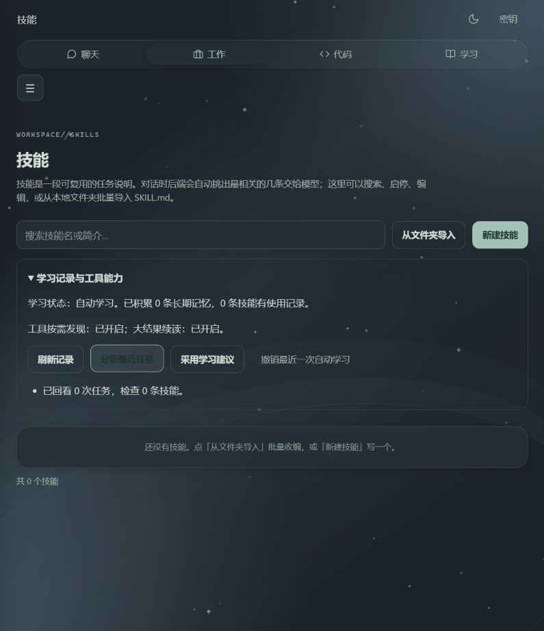

# Hermes 能力增强：最终集成验收

日期：2026-10-21。工作目录：`E:\blog-my`。环境：Windows、Go 1.25.3。主 agent 与三个子 agent 分别完成源码研究、工具工程、学习闭环，随后进行了独立审查。

工作基于进入本轮时已有的未提交 Hermes 对标代码继续完成。原有 Electron、CUA、沙箱、公开访问等修改予以保留，不将其他修改混称为本轮独立产出。上游来源和初始差距见 [源码核验](../hermes-parity/03-source-audit-2026-10-21.md)。

## 已实现并核验的路径

| 路径 | 验证与结果 |
| --- | --- |
| 按需发现 | legacy 和真实 Eino ReAct 编排均验证搜索后下一次模型请求出现新工具参数定义，而非只更新目录 |
| 参数处理 | 本地 schema 引用先展开再净化，嵌套参数纠偏、必填、类型及枚举检查通过 |
| 大结果 | 完整保存、用户与会话隔离、同一会话续读、长单行 Unicode 分页通过；确认重放产生的结果可由继续会话读回 |
| 并行和取消 | legacy 只读批处理、顺序、预算、取消后不补发通过；Eino 仍串行，界面不将配置值当生效值 |
| MCP | 握手、工具列举、调用、错误、超时、关闭通过；追加真实 OS 子进程 stdio 握手/调用/EOF 回收测试通过 |
| 学习证据 | 保存脱敏后的实际参数与结果，候选带成功流程与验证步骤；先成功后失败不冒充修复，缺参数骨架不能自动固化 |
| 完整复用 | 两个执行器分别走真实 TCP/HTTP → 实际工具 → 轨迹 → MySQL 技能落库 → 后续会话检索注入 → 使用账本，全部通过 |
| 权限 | 主/子/确认重放共用能力装配；用途切换后旧风险调用不能绕过限制，等待确认不计执行成功；MCP 和自动固化遵守工具集选择 |
| 隔离 | 不同用户的记忆、轨迹、账本和报告分目录；历史检索限定用户，猜测他人会话编号无结果 |
| 撤销 | 按批次恢复或停用自动生成技能，检查用户后续编辑冲突，日志失败对调用方可见 |
| 界面 | 在独立测试库启动真正后端，通过浏览器注册临时账号、打开技能页、展开学习面板、分析最近任务，状态与报告更新正常 |

## 执行结果

- `go build ./...`、`go build -o bin/blog-my.exe ./cmd/blog-my`：通过。
- `go vet ./...`：通过。本轮完整权限环境已能运行，不沿用较早报告的环境阻断结论。
- `gofmt -l internal cmd`：无未格式化文件。
- `go test ./... -count=1 -timeout 180s`：全部包通过；真实服务测试默认跳过。
- `npm run test:tooling`：3 项通过。
- `npm run test:electron`：13 项通过。
- `npm run test:ui`：四组浏览器模板回归通过，包括学习面板只读打开、安全文本、重复点击、采用/撤销后刷新、关闭档位和错误提示。
- `node --check templates/static/js/evolution.js`：通过。
- `AGENT_IT=1` 且使用新建独立测试库，运行 `TestHermesLearningLifecycleHTTP|TestHermesReview|TestChatHTTP|TestPermHTTPMatrix`：通过，`internal/web` 5.005 秒。
- 独立真实后端 `/api/health` 返回 200；未登录 `/api/agent/evolution` 返回 401。

本轮遇到并处理了 Windows 临时共享占用导致的记忆文件原子替换失败：只对已知 Windows 占用错误做至多五次重试，合计等待 150ms，不先删原文件。确定性测试及 `evolve -count=3` 通过。

旧 HTTP 权限测试通过“空库代表本机主人”的既有测试缝创建虚拟用户；在已注册浏览器测试账号的库上重跑会按真实非主账号权限被拒。最终权限矩阵使用另一份新建独立库通过，未放宽运行时权限迎合测试。

## 本地交付状态

项目开发用 `.env` 已启用 `AGENT_TOOL_DISCLOSURE=search`、`AGENT_TOOL_SPILL_BYTES=32768`、`AGENT_SKILL_LINT=block`、`AGENT_EVOLVE=auto`；保留原数据库和凭证配置。`bin/blog-my.exe` 已重新生成。重启开发版后生效，入口为“技能 → 学习记录与工具能力”。已安装桌面版有自己的配置目录，未改写其配置或重打安装包。

验证服务只监听 `127.0.0.1:8097`，已停止。临时账号和验证数据仅位于专用测试库；没有发布公网服务，没有推送 Git 或改动生产用户技能。学习数据与上游快照不进入源码发布。

## 尚未验证的边界

模型使用确定性桩；未把本轮当作真实云端模型的长期任务成功率评估。没有训练模型权重，也没有开放任意后台改写程序源码。

MCP 的真实进程生命周期已测，未安装或连接第三方 MCP 服务，HTTP/SSE MCP 不在已实现范围。完整 Electron 原生窗口的操作未重跑；Electron 自动测试、真实后端和浏览器界面分别验证。

Eino 的工具执行保持串行。更广的 Hermes 消息网关、定时调度、远程沙箱等不属于本轮完成声明。

结构落地见 [开发约定](../../CONTRIBUTING.md) 和 [ADR-0002](../adr/0002-agent-capability-assembly.md)；使用方式见 [能力指南](../hermes-parity/04-usage.md)。
